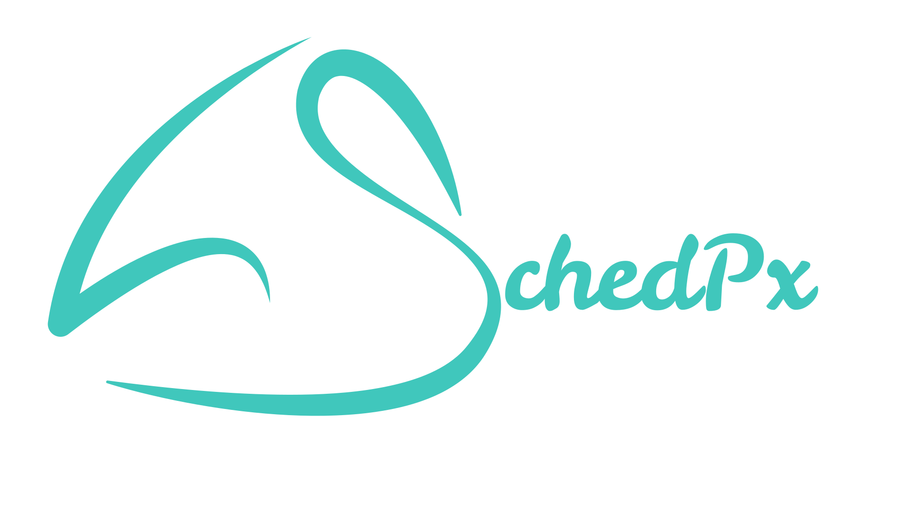

&#x20;\<p align="center">   \ \</p>

\<h1 align="center">SCHEDPX: PATIENT SCHEDULING & CASE MANAGEMENT SYSTEM\</h1>

\<h3 align="center">Full-Stack Patient Scheduling Application\</h3>
\<h5 align="center">Personal Portfolio Project · 2026\</h5>

\<p align="center">
&#x20; \
&#x20; \
&#x20; \
&#x20; \
&#x20; \
\</p>

## About

SchedPx is a full-stack patient scheduling and case management system designed for studentists. It provides a centralized interface for organizing patient records, managing patient-specific cases, configuring case types and task checklists, tracking case progress, and scheduling appointments.

Unlike a basic appointment calendar, SchedPx connects appointments to individual patient cases. This relationship helps organize scheduling around a patient's ongoing treatment or case workflow rather than treating each appointment as an isolated record.

The application uses a React and TypeScript frontend, a Laravel REST API, and a MySQL database. Docker Compose provides a containerized development environment for the frontend, backend, and database.

Originally developed under the name **Studentist scheduler**, the project was renamed **SchedPx** to better reflect its focus on patient scheduling and case management.

## Features

### Patient Management

- Maintain patient records in a centralized interface.
- View patient information and associated patient cases.
- Organize cases under their respective patients.
- Access patient details to support case and appointment management.

### Patient Case Management

- Associate individual cases with patients.
- Assign case types to patient cases.
- Organize case information independently for each patient.
- Connect patient cases with their related tasks and appointments.

### Configurable Case Types

- Manage case types used to categorize patient cases.
- Associate case types with task checklists or case-specific workflows.
- Support different sets of tasks for different case categories.
- Reuse case-type definitions when organizing patient cases.

### Task and Progress Tracking

- Organize tasks associated with individual patient cases.
- Manage case-related checklist items.
- Track task completion and case progress.
- Keep tasks connected to their corresponding patient cases.

### Appointment Management

- Create and manage appointments associated with patient cases.
- Retrieve the patient and case information associated with an appointment.
- Organize appointments around existing patient records and cases.
- Maintain relationships between appointments and case-related tasks where applicable.

### Dashboard and Navigation

- Provide a centralized dashboard for accessing patient and scheduling information.
- Navigate between Dashboard, Patients, Appointments, and Settings.
- Access patient details and case-related workflows through the application interface.

### Backend and Database Optimization

- Use Laravel Eloquent relationships to connect patients, cases, case types, tasks, and appointments.
- Apply eager loading to reduce unnecessary database queries when retrieving related records.
- Use relational database constraints to maintain data integrity.
- Separate frontend presentation from backend business logic through a REST API.

## Technology Stack

| Category                 | Technologies                                           |
| ------------------------ | ------------------------------------------------------ |
| Frontend                 | React, TypeScript, Vite                                |
| UI and Styling           | Tailwind CSS, CSS                                      |
| Backend                  | PHP, Laravel REST API                                  |
| Database                 | MySQL 8.0                                              |
| API Communication        | HTTP, JSON, REST                                       |
| Containerization         | Docker, Docker Compose                                 |
| Web Server               | Nginx                                                  |
| Development Tools        | Git, GitHub, VS Code                                   |
| Performance Optimization | Laravel Eloquent eager loading, SQL query optimization |

## Architecture

SchedPx follows a client-server architecture with separate frontend and backend applications.

1. **React frontend** — displays the dashboard, patient records, case information, task workflows, and appointment interfaces.
2. **Laravel REST API** — handles HTTP requests, validates input, performs application operations, and returns JSON responses.
3. **MySQL database** — stores patient records, case types, patient cases, tasks, appointments, and their relationships.
4. **Docker Compose** — coordinates the frontend, backend, web server, and database services in a local development environment.

### Application Workflow

The main data relationship follows this structure:

```text
Patient
  |
  +-- Patient Cases
        |
        +-- Case Type
        |     |
        |     +-- Configured Task Checklist
        |
        +-- Case Tasks
        |
        +-- Appointments
                |
                +-- Associated Tasks
```

A patient can have multiple patient cases. Each patient case belongs to a patient and a case type, and can have associated appointments, tasks, and images. Appointments can also be associated with tasks through a many-to-many relationship.

This structure allows SchedPx to organize case-related activities while keeping the patient, case, and appointment records connected.

## Database Design

The database uses relational tables and foreign-key relationships to organize patient scheduling and case management data.

### `patients`

Stores patient information.

- `id`
- Patient information fields defined by the application
- Timestamps

### `case_types`

Stores reusable categories for patient cases.

- `id`
- Case type information and configuration fields
- Timestamps

### `patient_cases`

Stores cases associated with individual patients.

- `id`
- `patient_id` — references the associated patient
- `case_type_id` — references the assigned case type
- Case-specific information fields
- Timestamps

### `tasks`

Stores tasks used in case-related workflows.

- `id`
- Task information and configuration fields
- Timestamps

### `patient_case_tasks`

Connects tasks to patient cases, supporting case-specific task tracking.

- Task and patient-case relationship fields
- Additional relationship fields defined by the schema

### `appointments`

Stores appointments associated with patient cases.

- `id`
- `patient_case_id` — references the associated patient case
- Appointment date, time, status, and other scheduling fields
- Timestamps

### `appointment_task`

Connects appointments to tasks through a many-to-many relationship.

- `appointment_id` — references an appointment
- `patient_case_task_id` — references a patient case task

### Relationships

- A patient can have multiple patient cases.
- A patient case belongs to a patient and a case type.
- A patient case can have multiple appointments and tasks
- An appointment belongs to a patient case.
- An appointment can be associated with multiple patient case tasks.
- A patient case task can be associated with multiple appointments.

The database also uses foreign-key constraints and indexes on relevant appointment date, time, and status fields to support relational integrity and scheduling queries.

*Note: The field descriptions above are representative. Refer to the Laravel migrations for the exact columns and constraints in the current schema.*

## Database Query Optimization

SchedPx uses Laravel Eloquent relationships to retrieve related patient and case information without unnecessarily querying each relationship separately.

For example, loading appointments together with their patient cases and associated patients can use eager loading:

```php
$appointments = Appointment::with(
    'patientCase.patient'
)->get();
```

Without eager loading, accessing the patient information for each appointment can trigger additional database queries. Eager loading retrieves the related records in a smaller number of queries.

During a controlled benchmark using seeded appointment data, the optimization produced the following results:

| Metric               |    Before |     After |
| -------------------- | --------: | --------: |
| Database query count |       201 |        3  |
<!-- | SQL execution time   | 347.34 ms |           | -->

*Benchmark note: The before measurement is from the larger simulated dataset experiment. The corresponding final optimized measurements should be taken from the same benchmark run before publishing a direct performance comparison.*

## Getting Started

### Prerequisites

Install the following tools before running the project:

- [Git](https://git-scm.com/)
- [Docker Desktop](https://www.docker.com/products/docker-desktop/)
- [Visual Studio Code](https://code.visualstudio.com/) (recommended)

### Installation

**1. Clone the repository**

```bash
git clone https://github.com/coochill/studentist-scheduler.git
cd studentist-scheduler
```

**2. Configure the backend environment**

Navigate to the Laravel backend directory:

```bash
cd patient-scheduler-backend
```

Create or configure the backend `.env` file using the environment settings required by the project.

Configure the database connection to match the Docker Compose service:

```dotenv
DB_CONNECTION=mysql
DB_HOST=mysql
DB_PORT=3306
DB_DATABASE=patient_scheduler
DB_USERNAME=schedpx
DB_PASSWORD=your_configured_password
```

Use the actual credentials defined in your local environment. Do not commit real credentials or `.env` files to version control.

Return to the repository root before continuing:

```bash
cd ..
```

**3. Build and start the Docker services**

```bash
docker compose up -d --build
```

**4. Prepare the Laravel application**

Generate an application key if one has not already been configured:

```bash
docker compose exec backend php artisan key:generate
```

Run the database migrations:

```bash
docker compose exec backend php artisan migrate
```

The application requires the configured database and migrations to be available before using the main features. If the project has seeders configured, run them when sample data is needed.

**5. Access the application**

The development configuration has used the following local endpoints:

- Frontend: `http://localhost:5173`
- Backend API: `http://localhost:8000/api`
- MySQL host port: `3307`

These endpoints depend on the active Docker Compose configuration. Check `docker-compose.yml` for the actual published ports and service names.

## Development Commands

**Check running services**

```bash
docker compose ps
```

**View service logs**

```bash
docker compose logs -f
```

**Run Laravel migrations**

```bash
docker compose exec backend php artisan migrate
```

**Check migration status**

```bash
docker compose exec backend php artisan migrate:status
```

**List API routes**

```bash
docker compose exec backend php artisan route:list --path=api
```

**Inspect Laravel application configuration**

```bash
docker compose exec backend php artisan about
```

**Rebuild the application containers**

```bash
docker compose up -d --build
```

**Stop the services**

```bash
docker compose down
```

The commands above assume the Compose services are named `backend`, `frontend`, and `mysql`. If the current Compose file uses different service names, substitute the corresponding names.

## Project Structure

The repository separates the frontend and backend into independent applications.

```text
studentist-scheduler/
├── patient-scheduler-backend/
│   ├── app/
│   │   ├── Http/
│   │   │   └── Controllers/
│   │   └── Models/
│   ├── database/
│   │   └── migrations/
│   ├── routes/
│   │   └── api.php
│   ├── Dockerfile
│   └── .env.example
│
├── patient-scheduler-frontend/
│   ├── src/
│   │   ├── components/
│   │   ├── pages/
│   │   ├── services/
│   │   └── App.tsx
│   ├── Dockerfile
│   └── package.json
│
├── docker-compose.yml
├── docker-compose.prod.yml
└── README.md
```

*The tree is representative; individual directories and files may differ in the current repository.*

## Roadmap

- [x] Separate React frontend and Laravel backend
- [x] Patient and patient-case data model
- [x] Case-type and task relationships
- [x] Appointment-to-patient-case relationship
- [x] Appointment-to-task relationship
- [x] Docker-based local development environment
- [x] Eloquent eager-loading optimization
- [x] Complete verification of all patient and case CRUD workflows
- [x] Verify appointment validation and scheduling edge cases
- [x] Improve targeted frontend refreshes after CRUD operations
- [x] Expand automated backend and frontend tests

## Project Status

SchedPx is a personal portfolio project focused on full-stack web development, relational database design, patient case management, and appointment scheduling.

The project uses a React and TypeScript frontend connected to a Laravel REST API and MySQL database. Its data model connects patients, patient cases, configurable case types, tasks, and appointments.

Development has also included work on database query efficiency through Eloquent eager loading and benchmark experiments.

The README and roadmap should be updated as additional workflows are verified and the application evolves.

## Author

**Joy Susette V. Domingo**
- Portfolio: [joysusette.vercel.app](https://joysusette.vercel.app)

## Setup Instructions

SchedPx runs on your Windows laptop through Docker Desktop. After the initial installation, you can open the application in your browser at:

```text
http://localhost
```

### One-time installation

1. Install [Docker Desktop for Windows](https://www.docker.com/products/docker-desktop/).
2. Open Docker Desktop and wait until it indicates that Docker is running.
3. Open **PowerShell** from the Windows Start menu.
4. Copy and run the following commands:

```powershell
Set-ExecutionPolicy -Scope Process Bypass
irm https://raw.githubusercontent.com/coochill/studentist-scheduler/main/Install-Studentist.ps1 -OutFile Install-Studentist.ps1
.\Install-Studentist.ps1
```

5. The installer will ask you to create:
   - A database password
   - A MySQL root password
   - Your login email
   - Your login password

   Keep these credentials private. Do not send them to anyone or commit them to version control.

6. When installation finishes, the browser should open automatically. If it does not, open [http://localhost](http://localhost) manually.

The first installation can take several minutes because Docker needs to download the application images and build the frontend.

### Daily startup

1. Open Docker Desktop and wait until it is running.
2. Open PowerShell.
3. Run:

```powershell
cd "$HOME\studentist-scheduler"
docker compose -f docker-compose.prod.yml up -d
Start-Process "http://localhost"
```

4. Sign in using the email and password created during installation.

Keep Docker Desktop running while using the application. You may minimize Docker Desktop; it does not need to remain visible.

### Daily shutdown

When finished, close the browser. You may leave Docker running, or stop the application to free system memory:

```powershell
cd "$HOME\studentist-scheduler"
docker compose -f docker-compose.prod.yml stop
```

Stopping the application does **not** delete patient records.

### Updating the application

When an update is available, open PowerShell and run:

```powershell
cd "$HOME\studentist-scheduler"
git pull --ff-only
docker compose -f docker-compose.prod.yml up -d --build
docker compose -f docker-compose.prod.yml exec backend php artisan migrate --force
```

Then open [http://localhost](http://localhost) again.

Normal updates preserve the database volume and are intended to retain patient records. Back up the database before updating.

### Backing up patient records

Create regular backups, especially before updating the application or making major changes to the computer.

Run the following PowerShell commands:

```powershell
cd "$HOME\studentist-scheduler"

$backupFile = "backup-$(Get-Date -Format yyyyMMdd-HHmm).sql"

docker compose -f docker-compose.prod.yml exec -T mysql mysqldump -u schedpx -p patient_scheduler > $backupFile
```

The command will prompt for the database password. Enter the password configured for the `schedpx` database user.

Store the resulting `.sql` file somewhere separate from the laptop, preferably on an encrypted drive or approved private storage. A backup stored only on the same laptop will not protect against laptop failure.

Before relying on a backup, verify that the resulting file exists and contains a valid SQL dump. Periodically test restoring a backup in a separate, non-production environment.

### If something goes wrong

First, check that Docker Desktop is running. Then inspect the application services:

```powershell
cd "$HOME\studentist-scheduler"
docker compose -f docker-compose.prod.yml ps
```

Services should be running, with `mysql`, `api`, and `frontend` showing `healthy` wherever a health check is configured.

To view recent errors:

```powershell
docker compose -f docker-compose.prod.yml logs --tail=100
```

**Important:** Do not run `docker compose down -v` unless you specifically intend to delete the associated Docker volumes. The `-v` option can permanently delete the database volume containing patient records.

For support, share the output of the `ps` command and the relevant error message. Never share `.env` files, passwords, login credentials, or database backup files.

### Important privacy reminder

SchedPx stores patient information. Protect the laptop with a Windows password, keep Windows and Docker Desktop updated, and do not share login credentials.

Do not use the application on a public or shared computer. Store patient data and backups securely, and follow applicable privacy and data-protection requirements.


